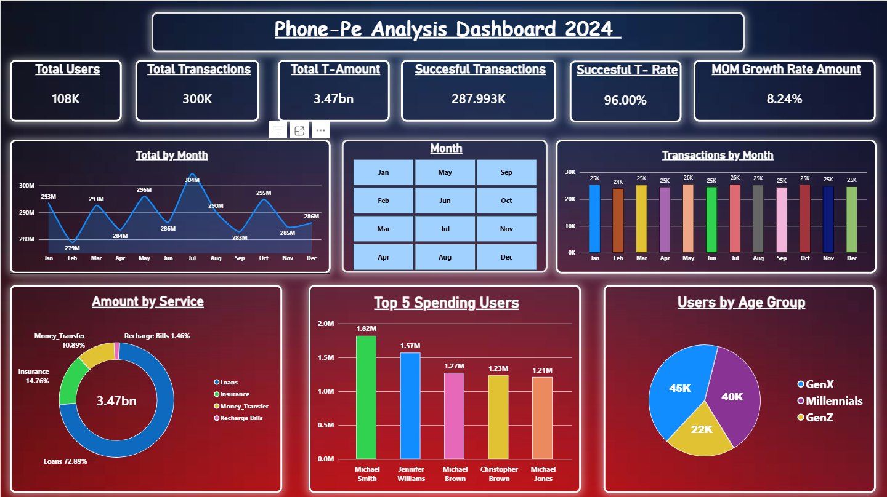

# PhonePe Transaction Analytics Dashboard 2024

## Project Overview
This project presents an interactive data analytics dashboard for analyzing PhonePe transaction and user data for 2024. It highlights transaction performance, monthly trends, service-wise transaction amounts, top-spending users, and user age-group distribution.

## Dashboard Preview



## Key Performance Indicators (KPIs)
- **Total Users:** 108K
- **Total Transactions:** 300K
- **Total Transaction Amount:** 3.47 billion
- **Successful Transactions:** 287.993K
- **Successful Transaction Rate:** 96.00%
- **Month-over-Month Growth Rate:** 8.24%

## Dashboard Features
1. **Monthly Transaction Amount:** Tracks transaction amounts across the year.
2. **Transactions by Month:** Compares monthly transaction volumes.
3. **Amount by Service:** Shows the distribution of transaction amounts across services.
4. **Top 5 Spending Users:** Identifies the five highest-spending users shown in the dashboard.
5. **Users by Age Group:** Compares the displayed GenX, Millennial, and GenZ segments.
6. **Monthly Filtering:** Provides a month-selection panel for exploring the dashboard.

## Tools and Technologies
- Microsoft Power BI
- Data visualization and business intelligence
- Data cleaning and transformation, if performed
- DAX measures
- SQL or Excel

## Project Structure
```text
phonepe-transaction-analytics/
├── dashboard/
│   └── PhonePe_Analysis_Dashboard_2024.pbix
├── images/
│   └── phonepe-dashboard.png
├── data/
│   └── README.md
├── README.md
└── .gitignore
```

## Key Insights
- The dashboard displays a total transaction amount of 3.47 billion.
- July shows the highest monthly transaction amount in the displayed chart.
- Loans account for the largest share of transaction amounts in the service breakdown.
- The successful transaction rate displayed is 96%.
- The dashboard compares spending across the top five displayed users.
These observations are based on the visualized values and should be validated against the underlying dataset before business decisions are made.

## Author
Aryan Nayak
